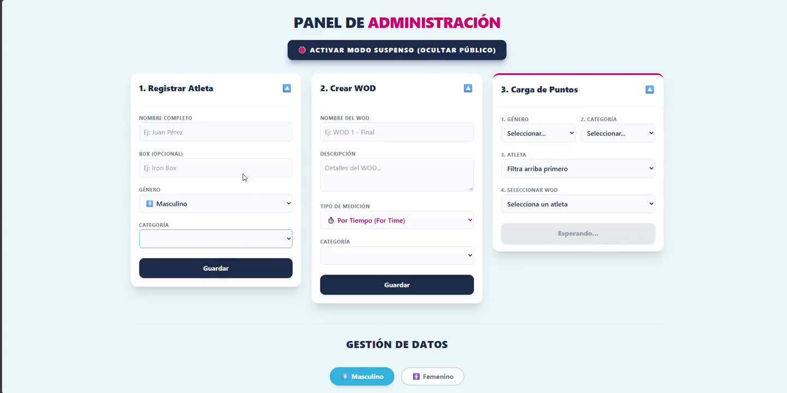

# Competencia «A toda costa»

Sistema para la competencia de CrossFit «A toda costa»: una tabla de posiciones en vivo para el público y un panel de administración pensado para cargar resultados rápido durante el evento.



[Ver el video de la demo en mi portafolio](https://sergio-cardozo.vercel.app/#p-atodacosta)

## Qué hace

- Tabla de posiciones en vivo, por categoría.
- Panel de administración para cargar atletas, WODs y resultados.
- Calcula puntajes y rankings por categoría, con criterio de desempate.
- Permite congelar la tabla mientras se cargan resultados.
- Pensado para usarse desde el celular durante el evento.

## Estructura

Es un monorepo con dos aplicaciones:

```
crossfit-backend/   API REST con NestJS y Prisma sobre PostgreSQL
crossfit-frontend/  tabla pública y panel de administración con Next.js
```

## Tecnologías

TypeScript · Next.js · React · Tailwind CSS · NestJS · Prisma · PostgreSQL

## Cómo ejecutarlo

Necesitás [Node.js](https://nodejs.org) en su versión LTS y una base de datos PostgreSQL.

**Backend**

```bash
cd crossfit-backend
npm install
cp .env.example .env   # y completar DATABASE_URL con tu base PostgreSQL
npx prisma migrate deploy
npm run start:dev
```

**Frontend**

```bash
cd crossfit-frontend
npm install
npm run dev
```

El frontend apunta a la API publicada; para usarlo con el backend local hay que cambiar esa dirección en `app/page.tsx` y `app/admin/page.tsx`.

## Autor

**Sergio Cardozo**, desarrollador full stack en Formosa, Argentina.
[Portafolio](https://sergio-cardozo.vercel.app) · [LinkedIn](https://www.linkedin.com/in/sergiocardozo-dev) · [GitHub](https://github.com/Gabicrdz)
